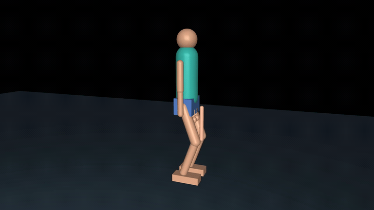
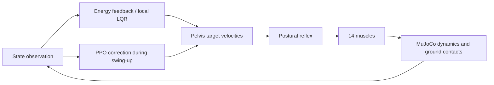

<h1 align="center">DickPole</h1>
<p align="center"><strong>A ridiculous balancing problem. Real physics.</strong></p>

<p align="center">
  <a href="media/presentation.mp4">
    
  </a>
</p>

An anatomically inspired take on **CartPole**: swing a hanging penis upright
and keep it balanced using only pelvis motion.

The environment is a planar MuJoCo humanoid with **14 muscles**, articulated
legs and ground contact. The included controller combines residual PPO,
local LQR stabilization and simulation-based policy selection.

## Quick start

Use Python 3.13. The pretrained model is included in `models/pretrained`.

```bash
python3.13 -m venv .venv
.venv/bin/python -m pip install -r requirements.txt

# Watch the pretrained controller
.venv/bin/mjpython main.py play
```

On macOS, use `mjpython` for the viewer. Allow a few seconds for the controller
to be selected before playback starts.

## Explore the environment

```bash
.venv/bin/mjpython main.py env
```

**Controls:** ← / → move the pelvis · ↑ / ↓ change height · A / D tilt ·
Space pause · R reset.

## Train

```bash
# Train a new policy
.venv/bin/python main.py train --steps 262144

# Fine-tune the included pretrained policy
.venv/bin/python main.py train --pretrained --steps 262144
```

Training runs PPO, refines the policy heads and builds a controller library
in `outputs/training`. To run your trained model:

```bash
.venv/bin/mjpython main.py play --model outputs/training
```

## Helicopter mode

A second task learns **front-facing 3D rotations** instead of upright balance.
The appendage starts hanging down at rest. Only lateral and vertical pelvis
motion can be commanded; the rotor remains passive.

[](media/spin.mp4)

```bash
# Watch the included helicopter controller
.venv/bin/mjpython main.py play --task spin

# Move the pelvis manually: arrows for lateral motion and height
.venv/bin/mjpython main.py env --task spin

# Learn controller parameters from episode rewards
.venv/bin/python main.py train --task spin --steps 262144

# Continue from the included controller
.venv/bin/python main.py train --task spin --pretrained --steps 262144

# Play / evaluate a newly trained controller
.venv/bin/mjpython main.py play --task spin --model outputs/spin_training
.venv/bin/python main.py evaluate --task spin --model outputs/spin_training
```

### Physics and objective

This task extends the body to **27 degrees of freedom and 24 Hill-type
muscles**, adding lateral pelvis translation, pelvis roll and antagonist
muscles for lateral trunk, hip and ankle control. Feet remain supported by
frictional ground contacts. Pelvis yaw is constrained. A passive hinge rotates
the appendage in the frontal plane; passive bending allows out-of-plane motion.
A fixed **0.28 m anterior stand-off** provides clearance for complete turns.
This deliberately simplified attachment is not anatomical validation.

With $`\theta`$ measured relative to the pelvis, downward is zero. For an
ideal rigid pendulum, lateral and vertical pivot accelerations obey

```math
I\ddot\theta + c\dot\theta + mgl\sin\theta
= -ml\left(\ddot y_p\cos\theta + \ddot z_p\sin\theta\right).
```

MuJoCo solves the complete articulated system, including muscle activation,
body reactions and contacts. There is **no rotor torque command** and no
externally applied force to hold the body upright. Actions change bounded
pelvis position targets, which the muscle reflex attempts to track.

The policy first pumps the pendulum for four seconds, then uses angle feedback
to synchronize lateral and vertical pelvis targets. A speed-dependent amplitude
reduction limits further energy input. **Cross-entropy policy search (CEM)**
learns eight controller parameters from physical rollouts: amplitudes, frequency,
phase, feedback mix, height, vertical phase and a speed threshold. This extension
uses episodic parameter search, rather than the balance task's residual PPO.
The controller includes a designed pumping pattern; it does not learn from
unstructured muscle commands.

For signed rotor advance $`\Delta\theta`$, decision interval $`\Delta t`$,
mean squared muscle activation $`A`$ and target speed $`\omega_* = 2\pi`$,
the environment reward is

```math
r_t = \frac{8\Delta\theta_{\mathrm{credited}}}{2\pi}
- \Delta t\left[0.01(\dot\theta-\omega_*)^2 + 0.005A
+ 2\mathbf{1}_{\mathrm{contact}}\right]
- 5\mathbf{1}_{\mathrm{fall}}.
```

Positive advances earn credit only without appendage contact; reverse motion
always loses credit. Search also rewards improvements to the episode's best
continuous rotation streak. CEM ranks survival and the best free rotation
streak first, followed by signed turns and episode return.
Back-and-forth swings cannot accumulate full turns.
Contact, sustained stalling or reversal resets the current streak. A rotation
is measured relative to the pelvis, so rolling the whole body does not count.
A successful episode requires **three consecutive free turns and no body fall
throughout 20 seconds**. Candidate policies are selected using independent
simulation copies before the live rollout, as in balance mode.

The bundled helicopter library passed **10/10 held-out episodes**, with
**23.2 turns in the mean best continuous streak** and no body falls.
See the [full helicopter validation](reports/spin_validation.json).
These results include simulation-based policy selection and describe this
mechanical model, rather than human anatomy.

## The control problem

DickPole is a **swing-up and balance problem**. The appendage starts pointing
straight down with zero velocity. The controller must inject energy through
pelvis motion, catch the unstable upright configuration, and keep it there
without falling or resting the appendage against the body.

The problem is **underactuated**: there is no actuator on the penis or the
testicles. Their motion emerges from gravity, passive joints, collisions and
the acceleration of their attachment points.

For intuition, a single rigid rod with a translating pivot approximately obeys

```math
I\ddot\theta
= mr(g+\ddot z_b)\sin\theta
- mr\ddot x_b\cos\theta
- b\dot\theta.
```

Here, $`\theta=0`$ is upright and $`\theta=\pi`$ is downward; $`(x_b,z_b)`$ is the
pivot position, $`r`$ the distance to the center of mass, and $`I`$ the inertia
about the pivot. Horizontal acceleration can push the rod toward balance;
vertical acceleration changes its effective gravity. Tilting the pelvis also
moves the attachment point. The actual simulation solves the coupled body,
not just this single-rod approximation.

## Physics engine

[MuJoCo](https://mujoco.readthedocs.io/en/stable/computation/index.html)
solves the articulated-body dynamics and contact forces. The model has
**19 mechanical degrees of freedom**:

| Part | Degrees of freedom |
| --- | ---: |
| Pelvis: horizontal position, height and pitch | 3 |
| Lumbar joint | 1 |
| Two shoulders and two elbows | 4 |
| Two hips, knees and ankles | 6 |
| Three appendage joints | 3 |
| Two suspended testicles | 2 |

The geometry is three-dimensional, but joint motion is restricted to the
sagittal plane. The penis is a chain of three rigid segments with passive
bending springs and damping. The testicles use rigid pendular attachments
with torsional compliance. Shoulders and elbows are passive; muscles actuate
the lumbar joint and the legs.

The equations of motion have the form

```math
M(q)\ddot q + h(q,\dot q)
= R F_{\mathrm{muscle}} + \tau_{\mathrm{passive}} + J(q)^T\lambda.
```

- $`q\in\mathbb{R}^{19}`$ contains positions and joint angles.
- $`M(q)`$ is the coupled mass and inertia matrix.
- $`h`$ contains gravity, Coriolis and centrifugal terms.
- $`R`$ maps muscle pulls into joint torques.
- $`\tau_{\mathrm{passive}}`$ contains spring and damping forces.
- $`J^T\lambda`$ contains contact and joint-limit reactions.

The feet are not welded to the floor. MuJoCo uses **regularized soft contacts**
with friction to compute support forces, sliding and separation. All body
segments can contact the ground. Appendages can also contact the body; other
skeletal self-collisions are filtered to avoid overlaps between simplified
capsule geometries.

Physics advances every **2 ms (500 Hz)** with MuJoCo's `implicitfast` integrator.
The controller acts every **20 ms (50 Hz)**, with ten physics steps per decision.

### Muscles and pelvis commands

There are **14 native MuJoCo muscle actuators**, arranged in antagonistic pairs
across seven joints. Their force depends on activation, length and shortening
velocity, with a passive tension component. Schematically, the pull magnitude is

```math
F_i = F_{\max,i}\left[
  a_i f_\ell(\tilde\ell_i)f_v(\tilde v_i)
  + f_p(\tilde\ell_i)
\right].
```

Muscle activation evolves separately:

```math
\dot a_i = f_{\mathrm{activation}}(e_i,a_i).
```

Excitation $`e_i`$ is bounded between 0 and 1. Activation is a dynamic state,
so changing excitation does not instantly change force. The configured
activation/deactivation time parameters are **10/40 ms**. Tendon moment arms
are fixed at **4 cm**, with a force scale of **6,000 N** per actuator.
See the [MuJoCo muscle model](https://mujoco.readthedocs.io/en/stable/modeling.html#muscle-actuators).

The high-level controller requests three pelvis target velocities:

| Request | Maximum target rate | Target range |
| --- | ---: | ---: |
| Horizontal translation | 0.6 m/s | ±0.14 m in the stance frame |
| Pelvis pitch | 2.4 rad/s | ±0.30 rad |
| Height | 0.5 m/s | 0.70–0.87 m |

These requests are integrated into pose targets. The hybrid controller caps
its height target at its calibrated standing height, approximately 0.8515 m.
**Targets are not imposed on the body**: a postural reflex computes joint
requests, then converts them into muscle excitations. Actual movement follows
from muscle forces, inertia and ground reactions. No external propulsion force
is applied directly to the pelvis.

## Learning and stabilization



PPO receives **67 observation values**: mechanical state, muscle activations,
controller targets and previous commands, elapsed time, pendulum angle and
energy features, control phase, and the baseline controller's commands.
Its three outputs are bounded residual corrections:

```math
u_t = \mathrm{clip}\left(
  u_{\mathrm{base}}(s_t) + \alpha(s_t)\,\delta u_{\mathrm{PPO}}(o_t),
  -1,1
\right).
```

During swing-up, $`\alpha=0.25`$. Near the upright configuration, $`\alpha=0`$:
the calibrated local controller takes over. Its horizontal and pitch
corrections use **LQR feedback**, $`\delta u=-K\delta s`$, obtained from a local
linearization of the muscular system. A separate height feedback restores
the standing target. PPO learns corrections to the ascent; it does not learn
the muscle reflex or replace the local stabilizer.

Training maximizes a discounted reward,

```math
J(\pi)=\mathbb{E}_\pi\left[\sum_t \gamma^t r_t\right],
\qquad \gamma=0.998.
```

Let $`H=(1+\cos\theta)/2`$, $`A`$ be the mean squared muscle activation, and
$`\psi`$ the pelvis pitch. The physical reward per decision is

```math
r_t = 2H^2 + 6\,\mathbf{1}_{\mathrm{upright}}
+ 0.3(1-|1-\mathcal{E}|)
- 0.005A - 0.03\psi^2.
```

A body fall adds a penalty of $`-2`$. PPO receives this reward multiplied by
0.01 to keep value estimates manageable; evaluation reports unscaled rewards.

$`\mathcal{E}`$ is the three-segment mechanical energy relative to the moving
pivot, including rotational inertia and bending springs, normalized so that
**downward at rest is 0** and **upright at rest is 1**. The energy term helps
discover swing-up before the policy has achieved an upright hold. The reward
is a learning objective; the reported outcome is the actual continuous hold.

### Why simulate multiple policies?

A cross-entropy search refines gains and biases in the PPO output layer,
producing complementary policy heads. Before an episode, the controller tests
candidates on independent copies of the current MuJoCo model and state, then
executes a selected policy in the untouched live environment.

This is **model-based hybrid control**, with access to the simulator's physics.
The planning rollouts do not move the live body or count toward its hold time.
The pretrained library also includes a zero-residual baseline; the successful
controller need not be a learned head in every episode.

## Success and scope

An upright hold requires all three conditions:

- Angle within **0.21 rad (about 12°)** of vertical.
- Angular speed below **1 rad/s**.
- **No appendage contact** with the body, ground or another non-appendage object.

A fall occurs if pelvis height drops below 0.55 m or its pitch exceeds 0.7 rad.
An episode succeeds with at least **5 continuous seconds** of free upright
balance and no body fall over the full episode.

The bundled system passed **20/20 evaluated episodes of 40 seconds**, with
**36.0 seconds mean continuous hold**. These results describe the complete
hybrid controller, including planning, on the provided physical model.
See [validation results](reports/validation.json).

This is a simplified mechanical benchmark, not a validated anatomical model.
It uses rigid segments, approximate muscle parameters and fixed tendon moment
arms. It does not simulate volumetric soft tissue, blood flow, muscle fatigue,
an independently learned walking controller. Balance mode is planar; helicopter
mode adds the lateral degrees of freedom described above.
