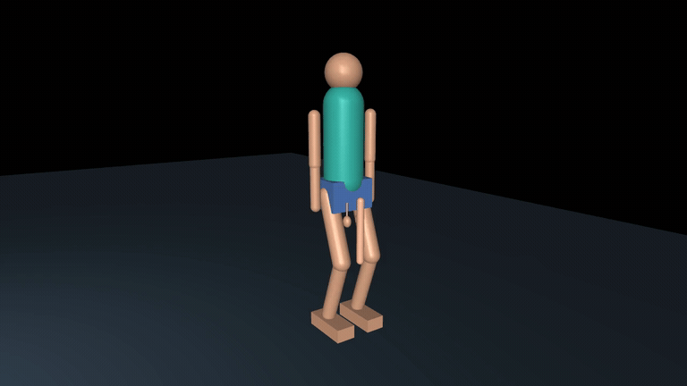

<h1 align="center">DickPole</h1>
<p align="center"><strong>A ridiculous control problem. Real muscle-driven physics.</strong></p>

<table>
<tr><th>Stand</th><th>Spin</th></tr>
<tr>
<td><a href="media/stand.mp4"></a></td>
<td><a href="media/spin.mp4"></a></td>
</tr>
</table>

Control a humanoid's pelvis to swing a passive appendage upright or rotate it
quickly. MuJoCo simulates muscles, articulated legs, passive appendages and
ground contact. The appendage has no motor. Previews show ten seconds of the
environment without overlays.

| Task | Body | Controller | Checkpoint |
| --- | --- | --- | --- |
| `stand` | Sagittal humanoid, 14 muscles | Residual PPO, LQR and profile selection | `models/stand/pretrained` |
| `spin` | 3D humanoid, 24 muscles, unlimited passive rotor | Hybrid controller and profile selection | `models/spin` |

The tasks use different physical models and incompatible policy interfaces.
`balance` is an alias for `stand`.

## Install and run

Use Python 3.13. Both pretrained controllers are included.

```bash
python3.13 -m venv .venv
.venv/bin/python -m pip install -r requirements.txt

.venv/bin/mjpython main.py play --task stand
.venv/bin/mjpython main.py play --task spin
```

On macOS, use `mjpython` for interactive viewing. Playback first selects a policy
using independent simulations, then starts the live episode hanging down at rest.

An additional spin checkpoint is included for playback without simulator lookahead:

```bash
.venv/bin/mjpython main.py play --task spin --model models/spin_online --no-plan --seed 5002
```

## Train

```bash
# Fine-tune the included checkpoints
.venv/bin/python main.py train --task stand --pretrained --steps 262144 --output outputs/stand
.venv/bin/python main.py train --task spin --pretrained --steps 262144 --output outputs/spin

# Run your trained policies
.venv/bin/mjpython main.py play --task stand --model outputs/stand
.venv/bin/mjpython main.py play --task spin --model outputs/spin
```

Omit `--pretrained` to start a new search, or use `--pretrained PATH` to continue
from your own compatible checkpoint. Stand trains PPO and refines a library of
policy heads. Spin uses multi-seed cross-entropy search with separate validation,
variance-aware scoring and saved optimizer state.

`--steps`, `--population`, `--rounds`, `--seed` and `--output` configure training.
Stand accepts `--learning-rate`; spin accepts `--episodes-per-candidate`.
Generated checkpoints and logs go in the ignored `outputs/` directory.

## Explore and evaluate

```bash
.venv/bin/mjpython main.py env --task stand
.venv/bin/mjpython main.py env --task spin

.venv/bin/python main.py evaluate --task stand --seed 3000 --episodes 20
.venv/bin/python main.py evaluate --task spin --seed 3000 --episodes 10

# Export ten seconds; requires FFmpeg
.venv/bin/python main.py video --task stand
.venv/bin/python main.py video --task spin
```

**Stand controls:** ←/→ translation, ↑/↓ height, A/D pitch.
**Spin controls:** ←/→ lateral, ↑/↓ height, W/S fore-aft, A/D pitch, Q/E roll.
Space pauses; R resets.

Stand passed **20/20** 40-second episodes, with **36 seconds mean continuous hold**.
Spin passed **10/10** planned episodes, averaging **2.46 turns/s**.
The standalone spin checkpoint passed **11/20** episodes without lookahead;
it is less reliable than planned playback.
See [stand results](reports/stand_validation.json),
[spin results](reports/spin_validation.json) and
[standalone spin results](reports/spin_online_validation.json).

## Physics and control

MuJoCo integrates at **500 Hz**; control runs at **50 Hz**. Native Hill-type
muscles act through tendons. Their force depends on activation, length and
shortening velocity, with activation/deactivation time constants of 10/40 ms.
A postural reflex converts pelvis targets into muscle excitations. Feet interact
with the ground through frictional contacts; no external force holds the body up.

The constrained multibody dynamics have the form

```math
M(q)\ddot q+h(q,\dot q)
=R(q)F_{\mathrm{muscle}}+\tau_{\mathrm{passive}}+J(q)^T\lambda.
```

Muscle pulls, passive springs and contact reactions determine motion. Actions
change pelvis targets, never physical positions or velocities directly.

**Stand** has 19 mechanical DOFs. Its policy observes 67 values and produces
three residual commands: pelvis translation, pitch and height. Energy pumping
raises the pendulum, PPO corrects the ascent, and local LQR feedback stabilizes
the upright configuration. Reward encourages height, energy and free upright
time while penalizing activation and falls. Success requires five continuous
seconds within **0.21 rad** of vertical, angular speed below **1 rad/s**, no
appendage contact and no body fall over the 40-second episode.

**Spin** has 27 mechanical DOFs. Its policy observes 94 values and commands five
pelvis target velocities: lateral, height, fore-aft, pitch and roll. Reward
credits signed free rotation toward a **2 turns/s** target and penalizes contact,
activation and falls. Contact, reversal or stalling resets the rotation streak.
Success requires three consecutive free revolutions, mean signed speed of at
least **1.5 turns/s after four seconds**, and no fall over 20 seconds.

These are approximate mechanical benchmarks with rigid segments and generic
muscles, not validated anatomical models.

## Tests

```bash
.venv/bin/python -m unittest discover -s tests -q
```
