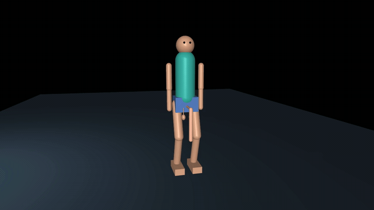
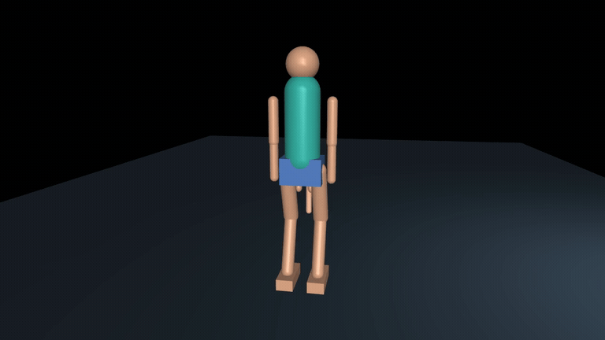

<h1 align="center">DickPole</h1>
<p align="center"><strong>One ridiculous humanoid. Two control problems. Real physics.</strong></p>

<table>
<tr><th>Balance</th><th>Fast rotation</th></tr>
<tr>
<td><a href="media/balance.mp4"></a></td>
<td><a href="media/spin.mp4"></a></td>
</tr>
</table>

Swing a hanging appendage upright, or make it rotate quickly in front of the
body. Both tasks use **exactly the same 3D MuJoCo humanoid**, with 24 muscles,
articulated legs, passive arms and testicles, and frictional ground contact.
Only the pelvis motion targets can be commanded. The appendage has no motor.

The root meets a rounded pelvis through a short flesh-coloured attachment;
there is no remote pivot or stand-off bar. The three-segment shaft is 21 cm
long. Both demonstrations show the first ten seconds of a real rollout.

## Run the trained controllers

Use Python 3.13. Both checkpoints are included.

```bash
python3.13 -m venv .venv
.venv/bin/python -m pip install -r requirements.txt

# Swing up from below and balance — reproducible demonstration
.venv/bin/mjpython main.py play --task balance --seed 7

# Rotate quickly, using the same body and attachment
.venv/bin/mjpython main.py play --task spin --seed 3000
```

On macOS, use `mjpython` for the viewer. Controller selection first evaluates
learned profiles in independent simulator copies. The live episode then starts
**hanging down at rest**. Playback repeats the requested seed.
Use `--no-plan` to run profile zero directly, without simulator lookahead.

| Task | Checkpoint | Measured result |
| --- | --- | --- |
| Balance | `models/balance` | **17.16 s** continuous free upright hold in a 20 s episode, seed 7 |
| Fast rotation | `models/spin` | **2.84 turns/s** mean after the initial four seconds; **10/10** tested seeds succeeded |

**Balance is seed-sensitive.** The seed-7 demonstration is reproducible, but
this is not a generally robust swing-up solution. The separate initial-state
checks are reported in [balance validation](reports/balance_validation.json).
The rotation results use seeds 3000–3009, distinct from training seed 7;
see [rotation validation](reports/spin_validation.json).
These measurements include simulator-based profile selection.

## Train either goal

```bash
# Fit two independent policies on the common 3D environment
.venv/bin/python main.py train --task balance --steps 262144
.venv/bin/python main.py train --task spin --steps 262144

# Continue training from an included checkpoint
.venv/bin/python main.py train --task balance --pretrained --steps 262144
.venv/bin/python main.py train --task spin --pretrained --steps 262144

# Run your trained policies
.venv/bin/mjpython main.py play --task balance --model outputs/balance --seed 7
.venv/bin/mjpython main.py play --task spin --model outputs/spin --seed 3000
```

Training uses **episodic cross-entropy policy search (CEM)**. It samples
controller parameters, runs physical episodes, retains the strongest policies,
and updates the sampling distribution. The controllers start from calibrated
pumping strategies; this is parameter search, not a neural PPO policy or
learning individual muscle control from scratch.

Balance learns nine energy-shaping, capture and feedback parameters. A bank of
local LQR controllers stabilizes the upright phase, with references for seven
lateral stance offsets. Spin learns eight oscillator parameters, including
amplitudes, phase feedback and speed-dependent energy reduction. Failed and
successful profiles can provide complementary behaviour in the final library.

`--steps` is a simulation-decision budget, rounded up to complete the current
episode. `--population`, `--rounds`, `--seed` and `--output` control the search.
Balance identification uses upright poses **only for offline linearization**;
training episodes, evaluation and playback always begin hanging down.

## Explore and evaluate

```bash
.venv/bin/mjpython main.py env --task balance
.venv/bin/mjpython main.py env --task spin

# Reproduce the balance demonstration
.venv/bin/python main.py evaluate --task balance --seed 7 --episodes 1

# Test different initial states
.venv/bin/python main.py evaluate --task balance --seed 3000 --episodes 10
.venv/bin/python main.py evaluate --task spin --seed 3000 --episodes 10

# Export ten seconds of environment-only footage; requires FFmpeg
.venv/bin/python main.py video --task balance --seed 7
.venv/bin/python main.py video --task spin --seed 3000
```

**Manual controls:** ← / → lateral pelvis motion · ↑ / ↓ height · Space pause · R reset.
Evaluation reports are written to `outputs/<task>_evaluation.json`.

## Shared environment architecture

```python
from dickpole import HumanoidEnv

balance = HumanoidEnv(task="balance")
spin = HumanoidEnv(task="spin")
```

The task changes the objective and a goal indicator in the observation.
**Geometry, masses, joint limits, muscles, contacts, initial-state distribution
and the two-action interface are shared.** Applying the same actions from the
same seed produces identical physical trajectories in both tasks.

- [humanoid.py](dickpole/humanoid.py): common 3D model, state, actions and task rewards.
- [environment.py](dickpole/environment.py): skeleton construction and muscle reflex.
- [learning.py](dickpole/learning.py): shared CEM training loop.
- [policy.py](dickpole/policy.py): checkpoint validation, selection and evaluation.
- [calibration.py](dickpole/calibration.py): local LQR identification.
- [models/humanoid.xml](models/humanoid.xml): exported physical model.

Each checkpoint records the same physical-model SHA-256 fingerprint and its
task. Loading a checkpoint for another geometry or goal raises an error.

## Physics and mathematical problem

The system has **27 degrees of freedom**: pelvis translation in three axes,
pelvis pitch and roll, articulated trunk and legs, passive arms, a frontal
rotor with out-of-plane bending, and two suspended testicular masses.
Pelvis yaw is constrained. Feet are not welded to the ground.

MuJoCo integrates at **500 Hz** using `implicitfast`; the controller acts at
**50 Hz**. The full constrained multibody dynamics have the form

```math
M(q)\ddot q + C(q,\dot q)+g(q)
= J_m(q)^T F_m + J_c(q)^T\lambda
- D\dot q-\nabla V_{\mathrm{passive}}(q).
```

Here $`M`$ is the inertia matrix, $`F_m`$ the muscle forces and $`\lambda`$ the
contact reactions. Ground friction and contact forces are solved by MuJoCo.
The body is supported by its feet and muscles; no external force holds it up.

The **24 native Hill-type muscle actuators** form antagonist pairs across the
trunk, hips, knees and ankles. Their force depends on activation, length and
shortening velocity. Activation has separate rise and fall time constants of
10 and 40 ms. Fixed tendon moment arms are 4 cm. A postural reflex converts
pelvis targets into joint torque requests and bounded muscle excitations.
Gravity and passive spring/damper joints drive the unactuated appendages.

The two actions are bounded lateral and vertical pelvis target velocities:

```math
a_t=(a_y,a_z)\in[-1,1]^2,\qquad
\dot y_* =0.5a_y,\quad \dot z_*=0.5a_z.
```

Targets are bounded to $`y_*\in[-0.14,0.14]`$ m and
$`z_*\in[0.78,0.87]`$ m. Actual motion follows muscle dynamics and contact
constraints; writing an action does not set the physical pelvis position.
Observations contain joint positions and velocities, muscle activations,
targets, previous actions, rotor angle and speed, time and the task indicator.

For intuition, a rigid frontal pendulum with angle $`\theta=0`$ downward obeys

```math
I\ddot\theta+c\dot\theta+mgl\sin\theta
=-ml\left(\ddot y_p\cos\theta+\ddot z_p\sin\theta\right),
```

where $`l`$ is its centre-of-mass distance from the pivot. MuJoCo solves the
complete three-segment body rather than this single-rod approximation.
The controller must inject or remove pendulum energy through pivot motion.

### Balance objective

The reward encourages height and free upright time while penalizing speed,
contact and body falls. With $`U`$ indicating a valid upright hold,

```math
r_t=\Delta t\left[2(1-\cos\theta)^2+20U
-0.02\dot\theta^2-2\mathbf{1}_{\mathrm{contact}}\right]
-5\mathbf{1}_{\mathrm{fall}}.
```

A valid hold requires the base-to-tip direction to lie within **0.21 rad of
world vertical**, angular speed below **1 rad/s**, and no appendage contact.
An episode succeeds with at least five continuous seconds of free balance and
no body fall throughout the 20-second episode. A fall means pelvis height below
0.55 m, pitch beyond 0.7 rad, or roll beyond 0.6 rad. LQR catches the upright phase;
the energy-shaping policy supplies the ascent.

### Fast-rotation objective

Rotation is measured **relative to the pelvis**, using the unlimited rotor
coordinate to count signed turns. Rolling the body or repeatedly swinging
back and forth cannot accumulate free consecutive revolutions.
With $`A`$ the mean squared muscle activation and $`\omega_*=4\pi`$ rad/s,

```math
r_t=\frac{8\Delta\theta_{\mathrm{credited}}}{2\pi}
-\Delta t\left[0.01(\dot\theta-\omega_*)^2+0.005A
+2\mathbf{1}_{\mathrm{contact}}\right]
-5\mathbf{1}_{\mathrm{fall}}.
```

Positive advance earns credit only in free motion; reverse motion always
loses credit. Contact, reversal or sustained stalling resets the current
streak. A successful fast-rotation episode needs three consecutive free turns,
mean signed free speed of at least **1.5 turns/s after four seconds**, and no
body fall. The 2 turns/s reward target is soft, rather than a hard speed limit.
Search additionally rewards improvements to the best episode hold or streak.

This is an approximate mechanical benchmark, not a validated anatomical model.
It uses rigid segments, generic muscle parameters and fixed tendon routing;
it does not simulate volumetric tissue, blood flow, fatigue or learned walking.

## Checks

```bash
.venv/bin/python -m unittest discover -s tests -q
```
